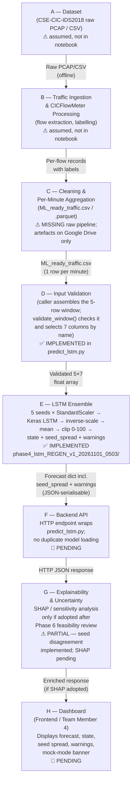

# SIH26153 — System Architecture
**AI-Based Network Attack Forecasting from Network Traffic Data**
*Author: Team Member 3 (Architecture & Backend Integration)*
*Date: 2026-11-14 | Branch: member3-architecture*

---

> [!IMPORTANT]
> This is a **PROVISIONAL, offline/batch-only** system.
> It forecasts the bot-traffic percentage for the **next minute** from a 5-minute window of aggregated features.
> It does **not** detect or prove individual network attacks.
> It has **never** been evaluated in a live, real-time, or production environment.
> Evaluated on **102 test targets from a single day** of the CSE-CIC-IDS2018 dataset.
> **Low-state recall is ~0%** on the test day — a "Medium" prediction does not mean traffic is safe.

---

## Table of Contents

1. [Component Overview](#1-component-overview)
2. [Mermaid Pipeline Diagram](#2-mermaid-pipeline-diagram)
3. [Component-wise Explanation](#3-component-wise-explanation)
4. [Data-Flow Explanation](#4-data-flow-explanation)
5. [Inter-Component Communication](#5-inter-component-communication)
6. [Implemented vs Pending](#6-implemented-vs-pending)
7. [Known Limitations](#7-known-limitations)

---

## 1. Component Overview

The system consists of **eight logical components** arranged in a linear pipeline. Some components are fully implemented, some are pending, and two inputs (raw PCAP ingestion and CICFlowMeter-to-per-minute aggregation code) are **known-missing** from the current workspace.

| # | Component | Status |
|---|-----------|--------|
| A | Dataset / Raw Traffic Source | MISSING (training artefacts only; raw pipeline not in repo) |
| B | Traffic Ingestion & CICFlowMeter Processing | MISSING |
| C | Per-Minute Aggregation | MISSING (training time); Present at inference as caller responsibility |
| D | Input Validation | IMPLEMENTED (`predict_lstm.py → validate_window`; caller assembles the window) |
| E | LSTM Ensemble Model | IMPLEMENTED (`phase4_lstm_REGEN_v1_20261101_0503/`) |
| F | Backend API Layer | PENDING |
| G | Explainability & Uncertainty Warnings | PARTIAL (seed disagreement + heuristic warning implemented; feature-level SHAP pending) |
| H | Dashboard / Frontend | PENDING |

---

## 2. Mermaid Pipeline Diagram



> [!NOTE]
> Dashed boundaries in prose below clarify **training-time** vs **inference-time** flow.
> At inference time, steps A–C are the **caller's responsibility**: the caller must supply
> exactly 5 consecutive 1-minute rows of the 7 required features; the backend does not
> regenerate or cache raw traffic.
>
> `seed_spread_pct_points` and `warnings` are produced by the forecast module (component E /
> `predict_next_minute()`) and are present in the output dict **before** the Backend API
> serialises the response. They are not added by a separate downstream stage.

---

## 3. Component-wise Explanation

### A — Dataset (CSE-CIC-IDS2018)

| Item | Detail |
|------|--------|
| Source | Canadian Institute for Cybersecurity, CIC-IDS-2018 dataset |
| Format | Raw network PCAP files + pre-extracted CSV flows |
| Used subset | A single day; the notebook's timestamps read 2018-02-03 (dates to be confirmed with Member 1) |
| Training artefacts | `ML_ready_traffic.csv`, `cic_ids2018_ml_ready.parquet`, train/validation/test parquet splits — **on Google Drive, not in this repo** |
| **Status** | ⚠ **MISSING** — the raw dataset files are not in this workspace. |

The notebook (`miniproject_CLEAN_v1 (1).ipynb`) begins from already-aggregated per-minute files. The step that produced those files from raw PCAP/CSV is **not documented in the notebook** and must be treated as a gap in the current documentation.

---

### B — Traffic Ingestion & CICFlowMeter Processing

| Item | Detail |
|------|--------|
| Tool | CICFlowMeter or equivalent flow-feature extractor — **assumed, not stated in the notebook** |
| Outputs | Per-flow CSV records with protocol features and bot/benign labels |
| Gap | The exact command, version, and configuration of CICFlowMeter used to produce the training data are **not recorded** in this workspace |
| **Status** | ⚠ **MISSING** — not in this repo; must be re-documented by Team Member 1 / data owner |

---

### C — Cleaning & Per-Minute Aggregation

| Item | Detail |
|------|--------|
| Training-time output | 1 row per minute, 7 aggregated features + `Bot_Pct` target |
| Known gap | There is a 207-minute gap in the data (05:29–08:56); windows must never span it |
| Inference-time | **Caller's responsibility** — the backend accepts a pre-aggregated 5-row window; it does not perform aggregation |
| **Status** | ⚠ **MISSING** for training-time code; at inference time it is a caller-side contract, not implemented here |

The 7 features that must be present in every inference window (raw, unscaled).
*Descriptions below are inferred from column names; to be confirmed with Member 1.*

| Feature | Description (inferred) |
|---------|------------------------|
| `Bot_Pct` | Percentage of flows classified as bot (0–100) |
| `Total_Flows` | Total flow count in the minute |
| `Fwd_Pkts_Bot` | Forward packets from bot flows |
| `Bwd_Pkts_Bot` | Backward packets from bot flows |
| `Fwd_Bytes_Bot` | Forward bytes from bot flows |
| `Bwd_Bytes_Bot` | Backward bytes from bot flows |
| `Avg_Duration_Bot` | Mean duration of bot flows (units to be confirmed with Member 1) |

---

### D — Input Validation

| Item | Detail |
|------|--------|
| File | `predict_lstm.py` → `validate_window()` |
| Caller responsibility | The caller assembles the 5-row window from pre-aggregated per-minute data before calling the module |
| What `validate_window()` does | Checks the window and selects the 7 columns by name; it does **not** assemble or aggregate data |
| Input | A `pandas.DataFrame` with ≥ the 7 feature columns + optional `Timestamp` |
| Window size | Exactly **5 rows × 7 features** |
| Consecutive check | If `Timestamp` column is present, rows must be exactly 60 s apart |
| **Status** | ✅ **IMPLEMENTED AND VERIFIED** (`selftest.py` all PASS, `extra_tests.py` 17/17 PASS) |

Error codes raised by `validate_window()`:

| Code | Trigger |
|------|---------|
| `MISSING_FEATURES` | One or more of the 7 feature columns absent |
| `BAD_SHAPE` | Window is not exactly 5 rows × 7 columns |
| `NAN_OR_INF` | Any cell is NaN or infinite |
| `NEGATIVE_VALUE` | Any cell is < 0 |
| `BOT_PCT_RANGE` | `Bot_Pct` > 100 in any row |
| `BAD_TIMESTAMP` | `Timestamp` column contains unparseable values |
| `NOT_CONSECUTIVE` | Rows are not exactly 60 s apart |

> [!CAUTION]
> Never silently fill gaps or drop rows to make the window fit.
> Every validation error must be surfaced to the caller as an HTTP error response.

---

### E — LSTM Ensemble Model

| Item | Detail |
|------|--------|
| Package | `phase4_lstm_REGEN_v1_20261101_0503/` (12 files) |
| Models | 5 Keras LSTM models (`lstm_primary_seed_42.keras` … `seed_46.keras`) |
| Feature scaler and target scaler | `scaler_features.joblib` (StandardScaler on 7 features), `scaler_target.joblib` (on `Bot_Pct`) |
| Config | `config.json` — records features, sequence length, scaler means, artifact version |
| Inference steps | 1. `scaler_features.transform(5×7)` → 2. each model predicts → 3. `scaler_target.inverse_transform` → 4. mean of 5 seeds, clipped 0–100 → 5. state from thresholds |
| Output | `predicted_bot_pct_next_minute` (float), `predicted_state` (Low/Medium/High), `seed_predictions` dict, `seed_spread_pct_points`, `warnings` |
| **Status** | ✅ **IMPLEMENTED** — do NOT modify `predict_lstm.py` or model files |

Performance on 102 test windows (single test day):

| Metric | LSTM Ensemble | Persistence Baseline |
|--------|--------------|---------------------|
| MAE | 6.92 | 9.31 |
| RMSE | 8.43 | 11.67 |
| R² | 0.62 | 0.27 |
| Low-state recall | **~0%** (all 23 Low targets → Medium) | 17.4% |

---

### F — Backend API Layer

| Item | Detail |
|------|--------|
| Purpose | Expose `predict_next_minute()` over HTTP; manage model lifecycle |
| Framework | **To be decided** (framework-independent contract specified in `docs/API_CONTRACT.md` — Phase 5) |
| Model loading | Load once at startup; never reload per-request; never load in the frontend |
| **Status** | 🔲 **PENDING** (Phase 5) |

Design principles (to be implemented):
- One module loads the model; `predict_lstm.py` is imported, never duplicated.
- Validation errors from `validate_window()` are mapped to HTTP 422 responses with the error code.
- The backend returns the full output dict (including `model_status`, `warnings`, `seed_predictions`) as JSON.
- The frontend must **never** load the model directly.

---

### G — Explainability & Uncertainty

| Item | Detail |
|------|--------|
| `seed_predictions` | Individual outputs of all 5 seed models — implemented in `predict_next_minute()` |
| `seed_spread_pct_points` | Range (max − min) of the 5 seed outputs — implemented in `predict_next_minute()` |
| Out-of-range heuristic | `forecast_app.py` flags any feature with \|z-score\| > 5 — **heuristic only, not validated, not in the ML contract** |
| `warnings` list | Returned in every response — implemented in `predict_next_minute()` |
| Feature-level SHAP | **NOT implemented** — pending technical feasibility review (Phase 6) |
| SHAP adoption | Only if adopted after the Phase 6 feasibility review |
| **Status** | ⚠ **PARTIAL** |

> [!WARNING]
> `seed_spread_pct_points` measures **ensemble disagreement**, not a statistically calibrated confidence interval.
> Do **not** label it as "confidence" or "SHAP" in any UI or document.

---

### H — Dashboard / Frontend (Team Member 4)

| Item | Detail |
|------|--------|
| Current state | `forecast_app.py` is a **demo Streamlit app** that loads the model directly — this violates the target architecture |
| Target state | Frontend calls the Backend API; never loads the model |
| Mock mode | If backend returns `model_status: "MOCK"`, the UI must show a visible banner; mock values must not be presented as real forecasts |
| **Status** | 🔲 **PENDING** (Phases 5 & 7) |

---

## 4. Data-Flow Explanation

### Training-time flow (historical — not repeatable from this repo)

```
[INFERRED — not in notebook] Raw PCAP/CSV  ──▶  CICFlowMeter  ──▶  per-flow CSV
[INFERRED — not in notebook]                        │
[INFERRED — not in notebook]            Label flows (bot / benign)
[INFERRED — not in notebook]                        │
[INFERRED — not in notebook]            Aggregate to 1 row per minute
[INFERRED — not in notebook]            (7 features + Bot_Pct target)
                                                    │
[VISIBLE IN NOTEBOOK]               Train/validation/test split
                                                    │
[VISIBLE IN NOTEBOOK]               StandardScaler fit (training rows only)
                                                    │
[VISIBLE IN NOTEBOOK]               LSTM training: 5 seeds (42–46), max 200 epochs
                                    with early stopping (patience 20), batch size 16,
                                    Adam lr 0.001, 16 LSTM units, dropout 0.2
                                    (from config.json); the package was retrained from
                                    the frozen config and is not byte-identical to the original
                                                    │
                                    Saved artefacts: .keras models, .joblib scalers,
                                    config.json, MANIFEST_sha256.txt
```

> [!IMPORTANT]
> The notebook starts from already-aggregated per-minute files hosted on Google Drive.
> Steps labelled **[INFERRED]** above the split were not observed in the notebook and
> cannot be verified from this repository. Any documentation of those steps must be
> clearly marked as **inferred or missing**.

---

### Inference-time flow (implemented)

```
Caller assembles 5 consecutive 1-minute rows
(7 raw features, unscaled, no data gap)
              │
              ▼
   predict_lstm.py → validate_window()
   ┌─ MISSING_FEATURES / BAD_SHAPE / NAN_OR_INF
   ├─ NEGATIVE_VALUE / BOT_PCT_RANGE
   ├─ BAD_TIMESTAMP / NOT_CONSECUTIVE  ──▶  InputValidationError (stop)
   └─ OK: validated 5×7 float array; 7 columns selected by name
              │
              ▼
   scaler_features.transform(5×7)  →  scaled array shape (1,5,7)
              │
     ┌────────┴────────┐
     ▼                 ▼              ... (5 seeds)
  seed_42.predict   seed_43.predict
     │                 │
  inverse_transform  inverse_transform
     └────────┬────────┘
              ▼
         mean of 5 → clip [0, 100] → Bot_Pct forecast
              │
         state_from_pct() → Low / Medium / High
              │
         Assemble output dict (JSON-serialisable)
         + seed_predictions, seed_spread_pct_points
         + warnings list
         [seed_spread and warnings produced HERE, inside predict_next_minute()]
              │
              ▼
   [PENDING] Backend API wraps this in HTTP JSON response
              │
              ▼
   [PENDING] Explainability layer — only if SHAP/sensitivity adopted
             after the Phase 6 feasibility review
              │
              ▼
   [PENDING] Frontend / Dashboard renders result
```

---

## 5. Inter-Component Communication

| From → To | Protocol / Format | Notes |
|-----------|-------------------|-------|
| Caller → Backend API | HTTP POST, JSON body | 5-row window as JSON array; exact schema in `docs/API_CONTRACT.md` (Phase 5) |
| Backend API → `predict_lstm.py` | Python function call | `predict_next_minute(pkg, window_df)` — in-process; no network hop |
| `predict_lstm.py` → Backend API | Python dict (JSON-serialisable) | Returned directly; includes `seed_spread_pct_points` and `warnings`; backend serialises to HTTP response |
| Backend API → Frontend | HTTP JSON response | Includes `model_status`, `warnings`, `seed_predictions`, `seed_spread_pct_points` |
| Frontend → User | Rendered UI | State label, forecast value, spread indicator, warning banners |

> [!NOTE]
> The backend must import `predict_lstm` once at startup and pass the loaded `pkg` object
> to every call of `predict_next_minute()`.
> This avoids reloading 5 Keras models per request (~seconds of overhead).

**Current deviation:** `forecast_app.py` loads the model directly in the Streamlit process. This is acceptable only as a demo. In the target architecture the frontend never touches the model files.

---

## 6. Implemented vs Pending

| Feature / Component | Status | Evidence / Notes |
|---------------------|--------|------------------|
| 5-seed LSTM ensemble models (`.keras`) | ✅ Implemented | `phase4_lstm_REGEN_v1_20261101_0503/`; hashes verified 11/11 |
| Feature scaler and target scaler (`.joblib`) | ✅ Implemented | Loaded and verified in `selftest.py` |
| Input validator (`validate_window`) | ✅ Implemented | `extra_tests.py` 17/17 PASS; all 7 error codes tested |
| `predict_next_minute()` output dict | ✅ Implemented | `predict_lstm.py`; schema matches `ML_INTEGRATION_CONTRACT_4.md` §5 |
| Seed disagreement (`seed_spread_pct_points`) | ✅ Implemented | Returned in every forecast response |
| `warnings` list in output | ✅ Implemented | Includes low-recall advisory, clipping notice |
| `model_status: "PROVISIONAL"` | ✅ Implemented | Hardcoded in `predict_next_minute()` |
| Mock mode (`model_status: "MOCK"`) | ✅ Defined in contract | Schema defined; a backend must honour the mock banner requirement |
| Demo Streamlit app (`forecast_app.py`) | ✅ Demo only | Loads model directly — **not the target architecture** |
| Out-of-range feature heuristic (z-score > 5) | ⚠ Heuristic | In `forecast_app.py` only; not validated, not in ML contract |
| **Backend HTTP API** | 🔲 **PENDING** | Phase 5 — `docs/API_CONTRACT.md` |
| **Frontend / Dashboard** | 🔲 **PENDING** | Phase 7 — `docs/FRONTEND_HANDOFF.md` |
| **Feature-level explainability (SHAP / sensitivity)** | 🔲 **PENDING** | Phase 6 — feasibility review in `docs/EXPLAINABILITY.md` |
| **Raw data ingestion pipeline (CICFlowMeter)** | ⚠ **MISSING** | Assumed, not in notebook; not in this repo |
| **Per-minute aggregation code (training time)** | ⚠ **MISSING** | Notebook starts from pre-aggregated files; source code not present |
| **Training dataset files** | ⚠ **MISSING** | On Google Drive only; not in workspace |

---

## 7. Known Limitations

These limitations apply to the entire system and must appear in all deliverable documents. They must never be hidden or softened.

1. **Provisional model only.** The LSTM ensemble is not production-validated.
2. **Single-day evaluation.** 102 test targets from one day of CSE-CIC-IDS2018. Generalisation to other days or networks is unknown.
3. **Low-state recall ≈ 0%.** All 23 Low-state targets on the test day were predicted Medium. A "Medium" prediction does not mean traffic is safe.
4. **Offline / batch only.** There is no live or streaming inference path. Never describe the system as "real-time" or "production-ready".
5. **Traffic state, not individual attacks.** The model forecasts the bot-traffic percentage of the next minute. It does not identify individual attack flows or attackers.
6. **GRU-V2 showed no clear advantage.** The ensemble RMSE difference vs LSTM is within bootstrap uncertainty. LSTM is the provisional integration model.
7. **Data gap hazard.** The training data contains a 207-minute gap (05:29–08:56). Inference windows must never span a gap in the input data.
8. **Missing preprocessing documentation.** The pipeline from raw PCAP to per-minute features is not fully documented and cannot be reproduced from this repository alone.
9. **Seed spread is not a calibrated confidence interval.** It is an ensemble disagreement measure only.
10. **Out-of-range heuristic is unvalidated.** The z-score > 5 flag in `forecast_app.py` is a heuristic added during integration, not part of the ML contract.

---

*End of ARCHITECTURE.md*
*Next: PHASE 4 — `docs/PREPROCESSING.md` (awaiting confirmation)*
